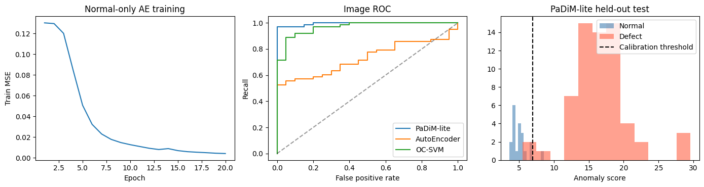
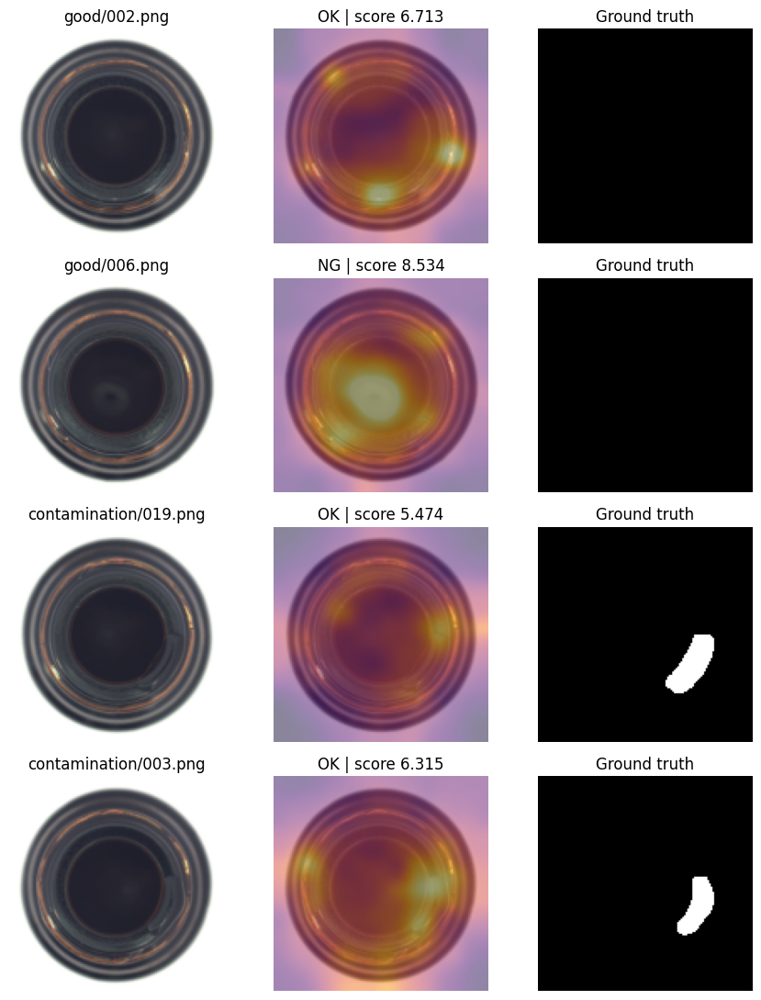
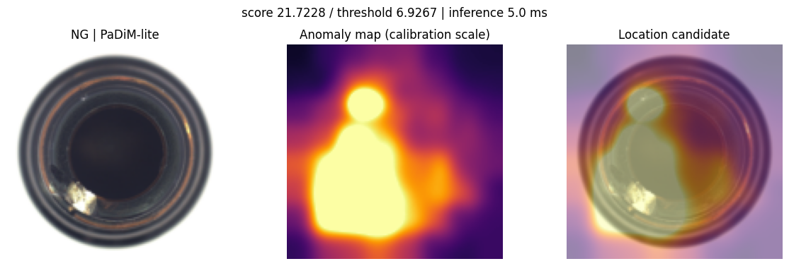
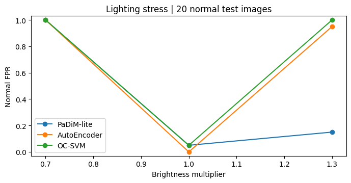

# 정상 이미지 기반 병 외관 이상탐지

정상 병 이미지만으로 깨짐과 오염을 탐지하는 외관 검사 시스템이다. MVTec AD의 bottle 데이터를 이용해 PaDiM-lite, AutoEncoder, One-Class SVM을 비교하고, 이미지 입력부터 OK/NG 판정, 이상 영역 시각화, 검사 이력 저장까지 연결했다.

구현과 실행 결과는 [bottle_inspection.ipynb](bottle_inspection.ipynb)에 포함되어 있다.

## 프로젝트 목적

불량 유형별 이미지를 충분히 모으기 어려운 상황에서 정상 제품의 특징만으로 외관 이상을 찾는 것이 목적이다. 제품 단위의 불량 판정과 함께 이상이 발생한 위치를 표시하고, 촬영 밝기가 바뀔 때 정상 제품의 오탐률이 어떻게 달라지는지도 확인했다.

## 데이터와 실험 조건

MVTec AD의 bottle 카테고리를 사용했다. 불량 유형은 큰 깨짐(`broken_large`), 작은 깨짐(`broken_small`), 오염(`contamination`)이다.

| 구분 | 정상 | 불량 | 용도 |
|---|---:|---:|---|
| 학습 | 167장 | 0장 | 정상 특징 및 복원 패턴 학습 |
| 보정 | 42장 | 0장 | 판정 임계값 설정 |
| 테스트 | 20장 | 63장 | 탐지 성능 평가 |

입력 크기는 128×128이며, 난수 시드는 42로 고정했다. 학습 데이터에만 모델과 스케일러·PCA를 맞추고, 정상 보정 데이터에서 구한 임계값을 테스트 전체에 적용했다. 이상 점수가 임계값보다 크면 NG로 판정한다.

- **PaDiM-lite**: ImageNet 사전학습 ResNet18의 세 특징층을 결합했다. 16×16 위치별로 선택한 48개 특징 채널의 평균과 공분산을 구하고 Mahalanobis 거리를 계산한다.
- **AutoEncoder**: 정상 이미지를 복원하는 CNN을 20 epoch 학습했다. 입력과 복원 이미지 사이의 RGB 평균 제곱 오차를 이상 맵으로 사용한다.
- **OC-SVM**: ResNet18의 전역 특징에 표준화와 32차원 PCA를 적용한 뒤 RBF One-Class SVM을 학습했다.

PaDiM-lite와 AutoEncoder의 이미지 점수는 이상 맵에서 상위 1% 픽셀의 평균이다. PaDiM-lite는 원 논문의 해상도·특징 차원과 이미지 점수 집계를 조정한 구현이다.

## 모델별 비교 결과

| 모델 | Image AUROC | Precision | Recall | F1 | 정상 FPR | Pixel AUROC |
|---|---:|---:|---:|---:|---:|---:|
| **PaDiM-lite** | **0.9944** | 0.9839 | **0.9683** | **0.9760** | 0.0500 | **0.9750** |
| AutoEncoder | 0.7310 | 1.0000 | 0.4603 | 0.6304 | 0.0000 | 0.6322 |
| OC-SVM | 0.9667 | 0.9825 | 0.8889 | 0.9333 | 0.0500 | — |

| 모델 | 검출한 불량 | 놓친 불량 | 정상 오탐 |
|---|---:|---:|---:|
| PaDiM-lite | 61 / 63장 | 2장 | 1 / 20장 |
| AutoEncoder | 29 / 63장 | 34장 | 0 / 20장 |
| OC-SVM | 56 / 63장 | 7장 | 1 / 20장 |

이번 bottle 테스트에서는 PaDiM-lite가 가장 높은 AUROC와 Recall, F1을 보였다. AutoEncoder는 정상 오탐이 없었지만 불량 34장을 놓쳤다. OC-SVM은 불량 56장을 검출했으며, 이미지 단위 판정에 사용된다. 위치 맵을 출력하지 않으므로 픽셀 지표는 계산하지 않았다.

### 어려운 사례

정상 이미지 중 이상 점수가 높은 2장과 불량 이미지 중 이상 점수가 낮은 2장을 비교했다. 정상 이미지의 오탐과 오염 이미지의 미탐이 함께 나타났다.

### 단일 이미지 추론 시간

| 모델 | 중앙값 | 95백분위 |
|---|---:|---:|
| PaDiM-lite | 5.93 ms | 6.08 ms |
| AutoEncoder | 2.88 ms | 3.14 ms |
| OC-SVM | 4.42 ms | 4.55 ms |

Tesla T4에서 3회 워밍업 후 테스트 이미지 20장을 단일 입력으로 측정했다. PaDiM-lite와 OC-SVM의 시간에는 CNN 특징 추출이 포함된다. 파일 읽기, 이미지 크기 조정, CSV 기록과 화면 표시는 제외했다.

## 검사 화면

**이미지 입력 → 모델 추론 → 임계값 판정 → 이상 영역 표시 → CSV 기록**

검사 화면은 노트북 위젯으로 구성했다. 테스트 이미지 83장을 선택하는 샘플 목록과 PNG/JPEG 업로드 입력, 모델 선택 항목을 제공한다.

- **단일 검사**: 선택한 이미지의 OK/NG 판정, 이상 점수, 임계값과 추론 시간을 표시한다.
- **위치 시각화**: PaDiM-lite와 AutoEncoder는 원본 이미지, 이상 맵, 원본 위에 겹친 이상 맵을 표시한다. 색 범위는 정상 보정 데이터에서 고정했다.
- **연속 검사**: 고정 난수로 선택한 테스트 이미지 10장을 순차 처리하고 판정과 추론 시간을 표로 표시한다.
- **검사 이력**: `inspection_log.csv`에 세션, 검사 시각, 이미지 경로, 모델, 점수, 임계값, 판정과 처리 시간을 누적한다.

아래는 PaDiM-lite 검사 결과 예시다. 이상 점수가 높은 위치를 색으로 표시하며, 정답 마스크는 검사 입력에 사용하지 않는다.

세 모델 모두 저장 후 재로딩한 점수와 판정의 일치를 확인했다. 검사 화면의 단일 검사와 10장 연속 검사도 판정·시각화·CSV 기록까지 동작을 확인했다.

## 밝기 변화에 따른 오탐

정상 테스트 이미지 20장의 픽셀 밝기를 0.7배, 1.0배, 1.3배로 바꾸고 같은 모델과 임계값을 적용했다.

| 밝기 배율 | PaDiM-lite FPR | AutoEncoder FPR | OC-SVM FPR |
|---|---:|---:|---:|
| 0.7배 | 100% | 100% | 100% |
| 1.0배 | 5% | 0% | 5% |
| 1.3배 | 15% | 95% | 100% |

밝기를 0.7배로 낮추면 세 모델 모두 정상 20장을 NG로 판정했다. PaDiM-lite도 밝기를 1.3배로 높였을 때 오탐이 1장에서 3장으로 증가했다. 원래 촬영 조건에서의 탐지 성능과 밝기 변화에 대한 안정성은 차이가 있었다. 촬영 조건 고정과 다양한 조명의 정상 이미지 확보가 후속 개선 과제다. 정상 테스트가 20장이므로 오탐 1장에 따라 FPR은 5%p씩 달라진다.

## KPT 회고

**Keep — 유지할 점**

정상 학습, 임계값 보정, 테스트를 분리하고 세 모델을 같은 조건에서 비교한 방식은 계속 유지하고 싶다. 특히 판정 결과를 이상 맵과 검사 로그로 연결하면서, 지표와 개별 이미지의 결과를 함께 확인할 수 있었던 점이 좋았다.

**Problem — 아쉬운 점**

PaDiM-lite의 AUROC는 0.9944였지만, 밝기를 0.7배로 낮추자 정상 20장을 모두 불량으로 판정했다. 이번 결과에서 가장 아쉬운 부분은 촬영 조건이 바뀔 때 정상 판정이 크게 흔들렸다는 점이다. 정상 테스트가 20장뿐이라 오탐률을 충분히 평가하기에도 표본이 작았다.

**Try — 다음에 시도할 점**

다음에는 학습에 사용하는 정상 이미지의 밝기 범위를 넓혀 조명 변화에 대한 민감도를 줄여보고 싶다. PaDiM-lite가 놓친 오염 이미지 2장도 입력 해상도를 높여 다시 비교하려 한다. 개선 여부는 AUROC뿐 아니라 불량 검출률, 정상 오탐률과 처리 시간을 함께 보고 판단하겠다.

### 실행할 액션

| 액션 | 실행 방법 | 완료 기준 |
|---|---|---|
| 밝기 증강 비교 | 정상 학습 이미지에 0.7~1.3배 밝기 증강을 적용한 PaDiM-lite를 추가 학습한다. 기존 데이터 분할과 보정 방식은 유지한다. | 기존 모델과 증강 모델의 Recall 및 밝기별 FPR을 한 표에 정리한다. |
| 미탐 사례 해상도 비교 | PaDiM-lite의 입력 크기를 128×128과 256×256으로 비교한다. 특징 격자·채널 수·난수 시드는 고정하고, 각 모델의 임계값은 같은 정상 보정 이미지에서 다시 계산한다. | 미탐 오염 이미지 2장의 이상 맵과 판정, 전체 테스트의 Recall·FPR·추론 시간을 비교한다. |

## 참고 자료와 데이터 출처

- [MVTec AD](https://www.mvtec.com/research-teaching/datasets/mvtec-ad) — MVTec Software GmbH
- [PaDiM 논문](https://arxiv.org/abs/2011.08785) — Thomas Defard 외
- [PyTorch ResNet18](https://docs.pytorch.org/vision/stable/models/generated/torchvision.models.resnet18.html)
- [scikit-learn One-Class SVM](https://scikit-learn.org/stable/modules/generated/sklearn.svm.OneClassSVM.html)

데이터는 `foersben/mvtec-ad` 공개 미러의 커밋 `c75b39616f84db43677bcc8228caaafaf5096d7f`를 사용했다. 원본 데이터와 이를 이용한 예시 이미지의 라이선스는 [CC BY-NC-SA 4.0](https://creativecommons.org/licenses/by-nc-sa/4.0/)이다.
